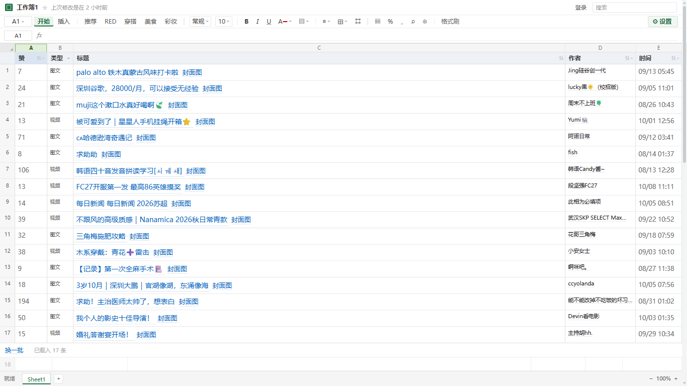
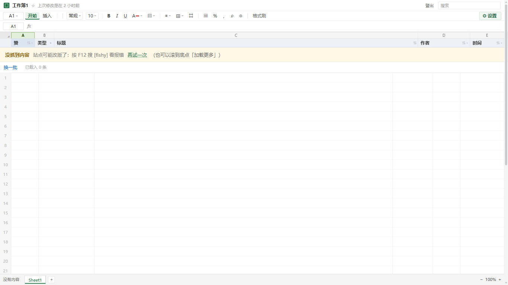
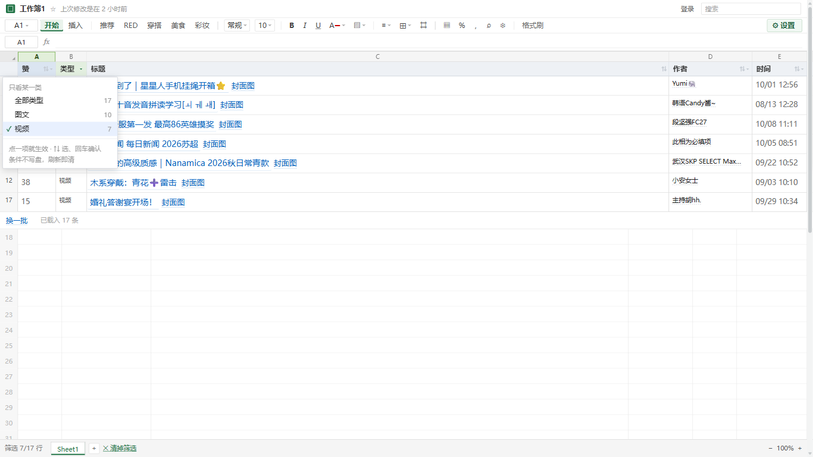
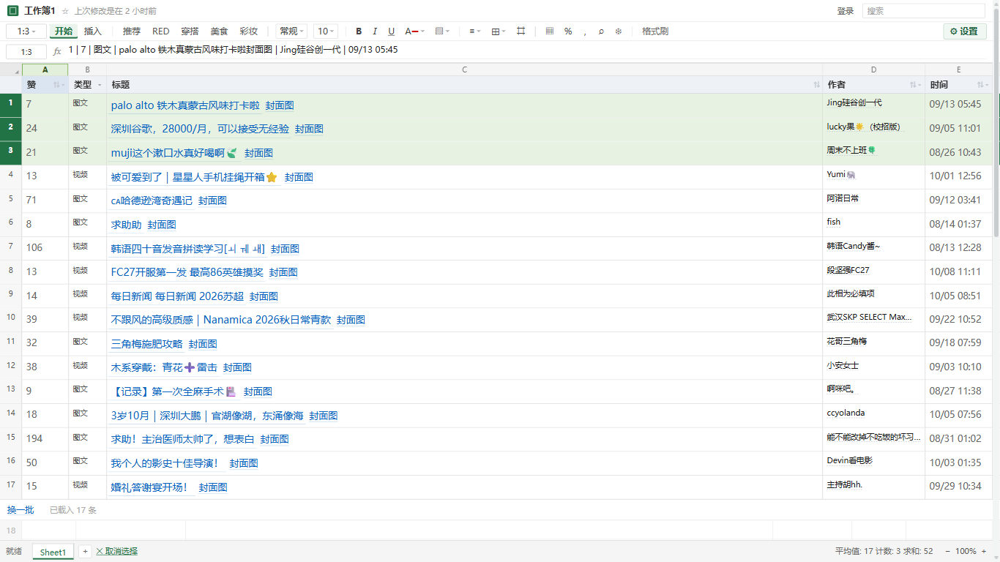
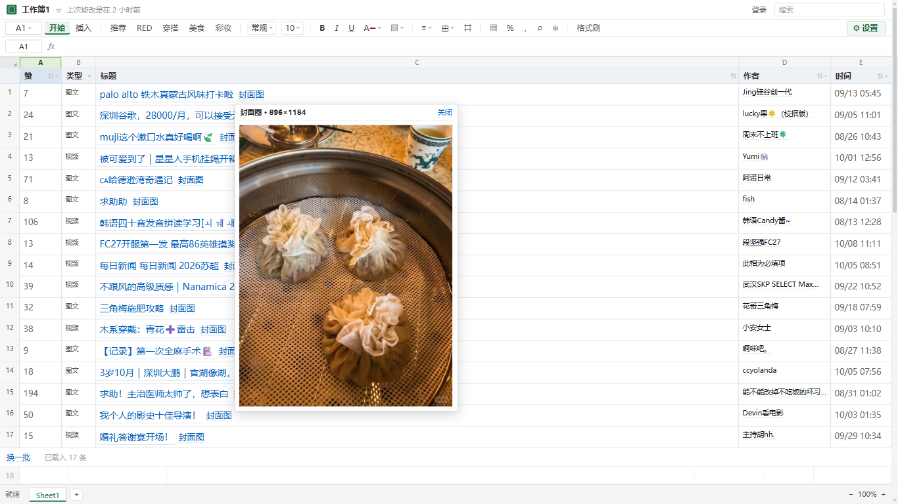
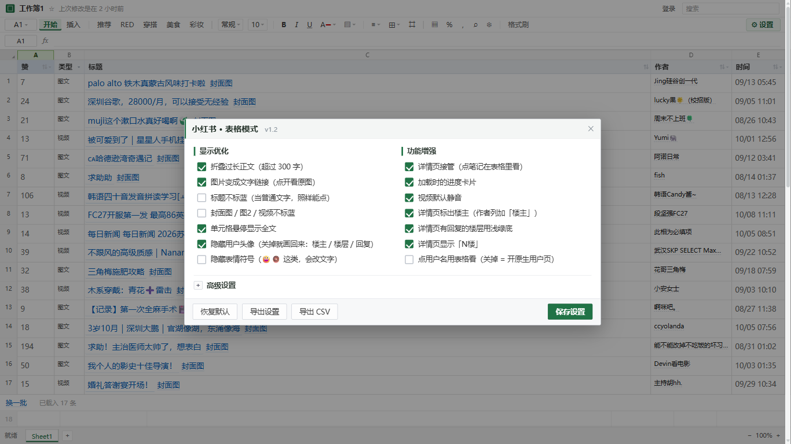
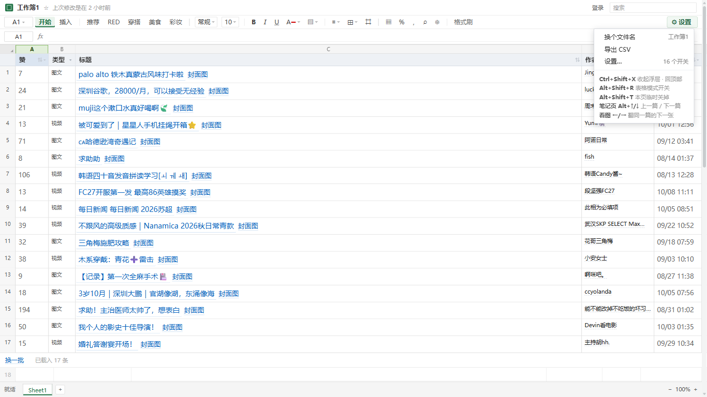

# 小红书 · 表格模式

把小红书网页版变成一张 Excel 表格。

左边是假工具栏，中间是「工作簿1」的网格，一帖一行。图片不会铺满屏幕，只在格子里留一串蓝色链接。老板从背后走过，看到的是一份表格。

`v1.26` ｜ 作者 **haozi** ｜ 实现细节在 [DEV.md](DEV.md)



---

## 装

不需要本地服务，也没有安装页。

一、装个脚本管理器。[Tampermonkey](https://www.tampermonkey.net/) 最稳（Chrome / Edge / Firefox 都行）。Violentmonkey 也能跑。别的没试过。

二、拿脚本。直接点下面的链接，油猴会拦下来弹安装页：

```
https://raw.githubusercontent.com/d4r4q4-lgtm/xiaohongshu-fishy/main/xiaohongshu-fishy.user.js
```

raw 域名有时打不开。那就去仓库页点 `xiaohongshu-fishy.user.js`，右上角 Download raw file。文件名要保持 `.user.js` 结尾，不然油猴不认。

三、导入。三种都行，挑顺手的：

- 把下载的文件直接拖进浏览器窗口，油猴弹出安装页，点「安装」
- 油猴图标 → 管理面板 → 实用工具 → 导入
- 油猴 → 添加新脚本 → 清空模板 → 粘贴全文 → `Ctrl+S`

若拖进去只是把文件内容显示出来了，是油猴没开文件访问权限：设置 → 通用 → 配置模式选「高级」→ 勾上「允许脚本访问文件 URL」。

四、打开 `xiaohongshu.com`，`Ctrl+Shift+R` 强刷。看到绿色小方块和「工作簿1」就成了。所有子域都支持（`www` / `m` / `so`）。

---

## 首页

一帖一行。行号、列号、表头都在，列宽能拖，双击表头右边那条线会按内容自动调宽。

图片是一串蓝色链接：第一张叫「封面图」，后面依次是 图2、图3。点开才弹原图，不点就是文字。评论里的配图从 图1 开始编号，因为那不是封面。

**只有标题能点进详情。** 整行、整张卡片都不响应点击。以前是整行可点，手一偏就跳走了，点行号选中和打开笔记也容易混。标题为空的条目会显示「无标题」，同样能点，不会变成一条打不开的死行。

作者名也能点，开的是这个人的主页（新标签页）。名字是深色带虚线底，鼠标停上去才变蓝。

表格末尾那行是「换一批」，点了重新加载这一页，站点给一批新笔记。以前这里叫「加载更多」，要让脚本去驱动站点翻页，经常点了没反应；刷新最笨，但它不会骗你。

---

## 详情页

主贴占第一行，评论往下排。一楼一个「N楼」徽标；这一楼有回复的，行首会有一条深绿竖边、整行浅绿底，徽标也变绿。楼中楼照旧缩进，前面写 `↳ 回复 @某人`。

「展开 N 条回复」单独占一行，钉在本楼最后一条回复的下面。折叠时它贴在那唯一一条回复下面，展开后贴到最后一条下面，位置不变。站点一次只给几条，所以展开之后它常变成「再加载几条（已 x/y）」。

发帖人那一行有个棕色的「楼主」标记，他自己回复的楼层也会标出来。属地在 IP 那一列——主贴和每一楼都有，站点自己没公布的那几条就空着。



左上角有「← 返回列表」，从列表点进来的就退回原来那张表（筛选和排序都还在），直接把链接贴进浏览器的就去首页。

详情页只有一条滚动条——表格自己那条。页面本身这时候不滚，免得右边挂两条条子互相打架。

最下面那个「加载更多评论」是详情页唯一的加载入口。滚到底不会自己拉，点了才会。**点了九秒还没动静，按钮会自己恢复**，并且直说原因：没登录就写「没登录：站点不给更多评论了」，登录了还不动就写「站点没回应，过会儿再点一次」——不会让你对着一个「加载中…」干等。

---

## 筛选、排序、搜索

点表头那几列的 ▾ 出筛选面板，选项从当前数据里长出来的：有几类就列几类，带条数。赞可以按 ≥100、≥1000、≥1万 筛，`1.2万` 和 `9871` 这种写法都认。时间是今天 / 3 天 / 7 天 / 30 天。

筛完行号不变，状态栏写「筛选 9/33 行」，右边跟一个「✕ 清掉筛选」。想看回全部就点它，不用挨个开面板。



点列头能排序（标题 / 作者 / 时间），点一下升序、再点降序、第三次回原顺序。赞的排序在工具栏的 ⇅ 面板里。

顶部搜索框按作者、标题、类型筛行，空格分隔多个词，每个词都得命中。`Ctrl+F` 也是进这个框，不是浏览器那条查找条，那条横条会直接盖在表格上。

---

## 选中和复制

点最左边的行号选中整行，`Shift+点` 连成一段，选中后用 `↑` `↓` 走、`Shift+↑↓` 加行。名称框和公式栏会显示 `1:3` 和这一行的内容。

`Ctrl+C` 复制成制表符分隔的一张表，粘进 Excel、微信、飞书都还是表格。只复制看得见的行，筛掉的不进去。



想取消就点状态栏那个「✕ 取消选择」。Esc 我试过，容易和输入框、和浏览器自己的行为打架，最后还是撤了。

右键表格不再弹自绘菜单了（用不上），右键就是浏览器原本那个菜单。

---

## 看图

点「封面图」弹原图，同一篇的图用 `←` `→` 翻，右上角写着 `3/6`，翻到底绕回来。点别处或右上角 ✕ 关掉。



> 这个浮层刚修过一个 bug：站点会给页面上所有 `` 加一条内联的 `visibility:hidden` 当懒加载保护，连我们浮层里的图也被一起藏了，表现就是点开一个白框。现在用一条 `!important` 顶回来了。

---

## 设置

工具栏右边只剩一个 `⚙ 设置`。筛选和排序都走表头那几个 ▾，导出在设置菜单里，右上角不再堆按钮。

点设置会弹一张跟表格同款的白底方角对话框，一共 14 个开关 + 1 个文件名输入框，分两栏：



**左栏「显示优化」（13 项）**

- 列表页以表格形式展示
- 详情页以表格形式展示
- 用户页以表格形式展示
- 超过 300 字折叠
- **标题不标蓝**（不影响点击访问详情页）
- **图片、视频按钮不标蓝**（不影响点击查看图片、视频）
- 单元格悬停显示全文
- 隐藏用户头像
- 隐藏表情符号（😀🍩 等）
- 详情页标记楼主
- 高亮有回复的楼层
- 显示楼层
- 在浏览器内显示的标签名称（输入框，默认「工作簿1」）

**右栏「功能增强」（2 项）**

- 加载时显示提示
- 视频播放时默认静音

几个要点：

「不标蓝」是拆开的两个开关：标题一个、图片和视频一个。只想去掉标题的蓝、图还留着蓝，就把图片那个关着。两个都只是**颜色**上的差别，点击照旧能进详情、能看原图。

**隐藏表情默认是关的**，因为它会真的把文字里的 emoji 去掉，导出也跟着少字。`[偷笑R]` `[点赞R]` 这种小红书表情代码也算在内，一起清掉。想要一份干净的表再自己勾。

头像那个开关两头都管：勾着不画头像；取消勾选就把头像画回来，瀑布页画楼主，详情页画楼主、各楼层和回复，右上角那个自己的头像也跟着回来。

「详情页标记楼主」会在发帖人那一行加一个棕色的「楼主」小标记，他自己回复的楼层也会标出来，几十层楼里一眼能找到作者说了什么。

「高亮有回复的楼层」关掉之后，楼主的淡黄底和黄标也一起撤（只留行首那条绿线），整张表就是纯白的。

「用户页以表格形式展示」关掉就是新标签页开原生用户页；打开的话改成当前页跳过去，让表格接管。

改完点「保存设置」才生效，记在本地，刷新还认。

---

## 加载的时候

拉评论要借站点的手，大概 2 到 4 秒。这期间屏幕正中有一张卡片，写着在干什么、收到多少条，底下一条来回跑的进度条。整屏加一层很淡的白幕，但不挡操作，还能滚还能选。


万一哪条路径没收尾，25 秒后它自己撤掉，不会把「加载中」焊在屏幕上。

---

## 快捷键

不用背。点 `⚙ 设置` 打开菜单，底下那张卡片就这几条。



最值得记的只有一个：`Ctrl+Shift+X`，收起所有浮层。筛选面板、排序面板、菜单、看图、选区，一按全退，顺手回顶部。

其余几个：`Alt+Shift+R` 切表格模式，`Alt+Shift+T` 本标签页临时关掉（再按一次回来）。

导出、查找、点行号复制、Tab 走位这些以前写在卡片上的提示都撤了（功能还在，只是不再占卡片的地方）；对应的 `Ctrl+Shift+E`、`Ctrl+F`、`Alt+Shift+E`、`Alt+Shift+A` 键位也一起撤了，改用设置面板里的开关。

---

## 它做不到的事

赞和收藏得你亲手点。小红书会校验点击是不是真人，脚本模拟的一律被丢。所以有了那个红框：切到原生界面，把按钮圈出来，你点一下，表格自己回来。

回复也一样，要切回原生界面才能打字。

游客有量限。未登录时条数被限制，连续刷十几页之后连原生页面都翻不动。等一会儿，或者换个浏览器配置。

搜索结果页游客态是空的。表格顶上会写「搜索结果要登录才给」，给一个去登录的入口。

详情页拉评论只能借站点的手。接口有签名校验，脚本驱动不了。所以偶尔会慢，或者站点干脆不理你。

小红书改版就失效。DOM 一改，抓取就错位。遇到了来提 Issue。

列表的「时间」是创建时间，从笔记 id 前 8 位还原出来的。作者后来编辑过的话，详情页显示的是最后编辑时间，会比列表晚一点。两个都对，含义不同。

---

## 出问题怎么查

`F12` 打开 Console，一行：

```js
document.documentElement.dataset.fzWhy
```

| 返回 | 意思 |
| --- | --- |
| `ok` | 正常接管 |
| `warmup` | 刚进页面，还在等数据 |
| `busy` | 表格已经打开 |
| `closed` | 你手动关过这篇，不会自动弹 |
| `no-data` | 页面里没找到笔记数据 |
| `list` | 当前不是详情页 |
| `throw:...` | 渲染报错，后面是错误信息 |

还想看得更细，控制台里有个只读探针：

```js
__fzProbe.readNotePage()     // 它读到的标题、正文、图片
__fzProbe.readComments()     // 评论树
__fzProbe.csv()              // 导出的 CSV 长什么样（只看文本，不下载）
__fzProbe.cfg()              // 现在的设置
__fzProbe.setCfg('tableMode', false)   // 等于在菜单里点一下
__fzProbe.setCfgVal('hideEmoji', true) // 改任意一个开关，立刻重画
```

提 Issue 带上：浏览器版本、油猴版本、`fzWhy` 的返回值、截图。能省一半来回。

---

## 开发和自测

架构、数据抓取、伪装层的实现、评论树、筛选排序、选中复制、列宽、状态栏统计、遮罩时序、以及一百多条踩坑记录，都在 [DEV.md](DEV.md)。

```bash
node check.mjs              # 本地 345 条
node check.mjs --real       # 再加真机 70 多条（要一个开了调试端口的 Edge）
node check.mjs --real --sweep=6   # 再加 6 轮换数据巡检，约 3 分钟
```

仓库里只有主脚本和文档。`check.mjs`、`sweep.mjs`、`serve.mjs` 这些是我本地自测用的，没随仓库发布。

---

## 想让它自动更新

默认不带更新地址，脚本不连任何服务器。要自动更新就自己托管一份，在文件头加两行：

```js
// @updateURL    https://你的地址/xiaohongshu-fishy.user.js
// @downloadURL  https://你的地址/xiaohongshu-fishy.user.js
```

本地试的话 `python -m http.server 8125`，地址写 `http://127.0.0.1:8125/xiaohongshu-fishy.user.js`。

---

## 免责

- 仅供个人学习和技术研究，用来了解浏览器脚本、DOM 操作这些东西。
- 别用于商业用途，别绕平台的计费、权限或安全机制。
- 用出问题（账号异常、内容丢失）自己担。
- 不收集、不上传任何数据。脚本不向任何服务器发信息。
- 和小红书（行吟信息科技）没有关联。如有侵权请联系删除。
- 建议用接近正常浏览的节奏。任何自动化行为都可能触发风控。

MIT。脚本头部已声明 `@license MIT`，随便用、随便改。
