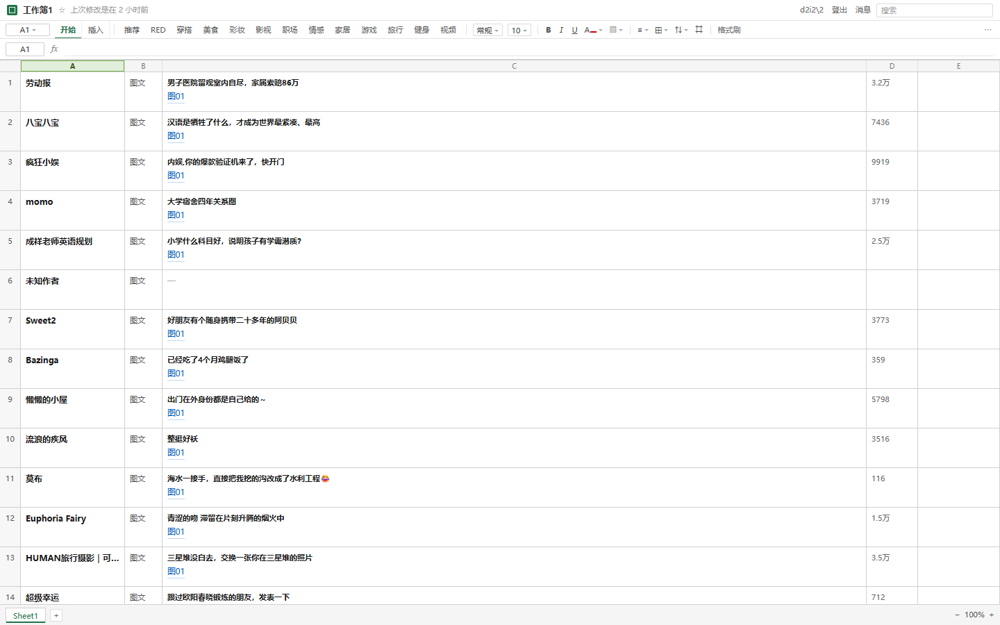
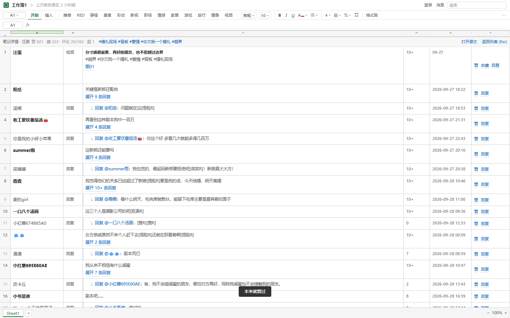
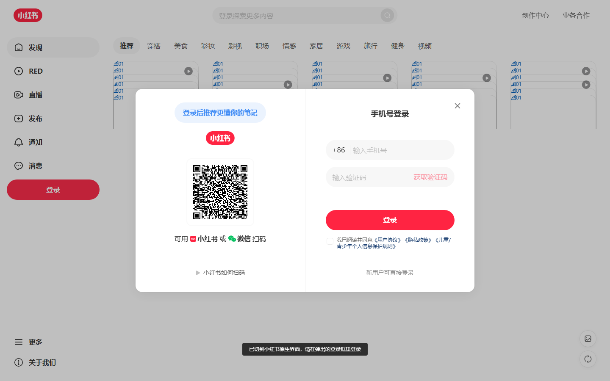

# 小红书 · 表格模式 🖐️🐟

> 把小红书web伪成 Excel 在线表格，方便摸鱼
>
> `v0.12` ｜ 作者 **haozi** ｜ [开发文档](DEV.md)



---

## 📖 第一次用先看这里

这脚本干的事只有一件：**把小红书伪装成表格**。

- 界面变成 Excel：标题栏、工具栏、公式栏、A/B/C 列号、行号、状态栏，一个不少
- 图片不再直接铺满屏幕，全部变成「图01」「图02」这样的蓝色文字链接，**点开才弹原图**
- 笔记正文和评论全部变成表格的**行**，一行一条，纵向排列
- 页面标题变成「工作簿1」，列表页怎么看都只是一份表格

一句话：**你老板从背后走过，看到的是 Excel。**

---

## ✨ 效果

**首页 —— 瀑布流变表格**


**详情页 —— 正文和评论变成同一张表的后续行，楼中楼带缩进**



**登录 —— 直接调起小红书自己的登录框，账号密码输在原生的地方**



---

## 🚀 安装

**不需要任何本地服务、不需要安装页，三步搞定。**

### 1. 装脚本管理器

| 管理器                                           | 说明                              |
| --------------------------------------------- | ------------------------------- |
| [Tampermonkey](https://www.tampermonkey.net/) | ✅ 推荐，Chrome / Edge / Firefox 都有 |
| Violentmonkey                                 | ✅ 基本可用                          |
| 其他                                            | ⚠️ 未测试，自求多福                     |

### 2. 拿到脚本文件（两种）

**方式 A：直接点链接安装**（最省事，油猴会自动拦截并弹安装页）

```
https://raw.githubusercontent.com/d4r4q4-lgtm/xiaohongshu-fishy/main/xiaohongshu-fishy.user.js
```

> raw 域名在部分网络环境下打不开。打不开就用方式 B。

**方式 B：下载文件再导入**

仓库页面点 `xiaohongshu-fishy.user.js` → 右上角 **Download raw file**（或 `Raw` 后另存为）。  
**文件名必须保持 `.user.js` 结尾**，否则油猴不认。

### 3. 导入油猴（任选一种）

| 方式         | 操作                                                                 |
| ---------- | ------------------------------------------------------------------ |
| **拖拽**（最快） | 把下载的 `xiaohongshu-fishy.user.js` **直接拖进浏览器窗口**，油猴会拦截并弹出安装页 → 点「安装」 |
| **油猴面板导入** | 点油猴图标 → 管理面板 → **实用工具** → 「导入」→ 选中那个 `.user.js` 文件                 |
| **粘贴**     | 油猴 → 添加新脚本 → 删掉模板内容 → 粘贴文件全文 → `Ctrl+S` 保存                         |

> 如果拖进去变成了"显示文件内容"而不是安装页，说明油猴没开**允许访问文件网址**：  
> 油猴设置 → 通用 → 配置模式选「高级」→ 勾选「允许脚本访问文件 URL」。

### 4. 打开小红书

`Ctrl + Shift + R` 强刷一次，看到绿色小方块 + 标题「工作簿1」就成功了。

支持两个站点的**所有子域**（国际版 rednote 同样能用）：

```
*xiaohongshu.com     国内版（www / m / so 等子域都覆盖）
*rednote.com         国际版（2026 年起海外账号会被强制跳转到这个域名）
```

---

## ⌨️ 快捷操作

| 场景 | 操作                 | 效果                          |
| -- | ------------------ | --------------------------- |
| 全局 | `Ctrl + Shift + X` | **一键收起所有浮层**（最常用，记住这个就够）    |
| 全局 | `Esc`              | 关闭当前浮层                      |
| 首页 | 点「图01」             | 看原图，点别处关                    |
| 首页 | 点行的空白处             | 进入笔记，变成详情表格                 |
| 首页 | 顶部搜索框              | 按作者 / 标题过滤                  |
| 详情 | 点「展开 N 条回复」        | 展开这一楼，默认只露第一条               |
| 详情 | 点「再加载几条（已 10/195）」 | 继续拉下一批（小红书一次给 10 条）         |
| 详情 | 点「赞 / 收藏」          | 切到原生界面 + 红框圈住按钮，你点一下，表格自动回来 |
| 详情 | 点「回复」              | 切到原生界面并聚焦输入框，直接打字           |

---

## ✅ 功能列表

- ✅ **首页接管**：瀑布流 → 表格，一帖一行，行号列号齐全
- ✅ **详情接管**：主贴第 1 行，评论按楼层往下排
- ✅ **楼中楼层级**：`↳ 回复 @某人` + 缩进，看得出谁回谁
- ✅ **图片全量**：主贴所有图列成「图01…图N」，不受轮播懒加载影响
- ✅ **评论折叠**：默认只露第一条，按钮显示「展开 195 条回复」
- ✅ **分批加载**：点一次多一批，带进度「已 10/195」
- ✅ **图片查看器**：点开看原图，支持键盘关闭
- ✅ **搜索过滤**：按作者 / 标题筛行，不动原数据
- ✅ **加载更多**：点「加载更多」行或滚到底
- ✅ **登录 / 登出**：调起原生登录框；登出是真退出账号
- ✅ **赞 / 收藏 / 回复**：调起原生按钮（脚本点不动时红框引导）
- ✅ **安全阀**：`Ctrl+Shift+X` 一键收起
- ✅ **防闪**：进入瞬间有遮罩，不会看到"先原版后表格"的闪烁

---

## ⚠️ 已知限制（用之前先知道）

1. **赞和收藏必须你亲手点一下。** 小红书会校验点击是否来自真人操作，脚本模拟的点击一律被丢弃。所以脚本做了个红框，把按钮圈出来给你点。
2. **回复要切到原生界面**才能打字（同上原因）。
3. **游客只能看约 30 条。** 小红书未登录就限制条数，不是脚本的问题。
4. **搜索结果页游客态是空的**（提示"登录后查看搜索结果"），登录后才正常接管。
5. **小红书改版会失效。** DOM 结构一变，抓取就可能错位。改版了来提 Issue。

---

## 🔧 出问题了怎么查

按 `F12` 打开 Console，输入：

```js
document.documentElement.dataset.fzWhy
```

| 返回          | 含义            |
| ----------- | ------------- |
| `ok`        | 正常接管          |
| `warmup`    | 刚进页面，等数据中     |
| `busy`      | 表格已打开         |
| `closed`    | 你手动关过这篇，不会自动弹 |
| `no-data`   | 页面里没找到笔记数据    |
| `list`      | 当前不是详情页       |
| `throw:...` | 渲染报错，后面是错误信息  |

想看更细的：

```js
window.__fzProbe.readNotePage()     // 它读到的标题/正文/图片
window.__fzProbe.readComments()     // 评论树
window.__fzProbe.readStateNote(id)  // 从站点数据里解析出的笔记
```

提 Issue 时请带上：**浏览器版本 + 油猴版本 + `fzWhy` 的返回值 + 截图**，能省一半沟通成本。

---

## 📦 进阶：想让它自动更新？

默认不带更新地址（不想让脚本偷偷连任何服务器）。想要自动更新，两个办法：

**A. 自己托管一份**  
把脚本放到你能访问的地方（GitHub raw、你自己的服务器、Greasy Fork），  
然后在文件头部加两行：

```js
// @updateURL    https://你的地址/xiaohongshu-fishy.user.js
// @downloadURL  https://你的地址/xiaohongshu-fishy.user.js
```

**B. 本地更新源**（仓库里带了）  
`serve.mjs` 是个只读小服务，跑起来后把上面两行指向 `http://127.0.0.1:8125/xiaohongshu-fishy.user.js` 即可。  
Windows 可用 `fishy-update-server.vbs` 做开机自启。

---

## 📁 目录

```
xiaohongshu-fishy.user.js   主脚本（只需要装这一个文件）
README.md                   本文件
DEV.md                      开发文档：架构、实现、18 条踩坑清单
LICENSE                     MIT
docs/images/                截图

—— 以下是开发/自测用，普通用户不用管 ——
serve.mjs                   本地只读更新源（可选）
fishy-update-server.vbs     Windows 开机自启更新源
check.mjs                   一键自测：本地 + 真机
sweep.mjs                   真机巡检（批量笔记）
real-check.mjs              真实站点断言
cdp.mjs / cdp-lib.mjs       CDP 驱动工具
test.html                   本地单元用例（52 条）
test-scroll.html            滚动/稳定性用例（18 条）
```

---

## 🛠 开发

架构、数据获取策略、伪装层实现、评论树、测试体系、18 条踩坑清单都在 **[DEV.md](DEV.md)**。

自测一条命令：

```bash
node check.mjs --real --sweep=6     # 约 2 分钟，92 条断言
```

---

## ⚖️ 免责声明

- 本项目**仅供个人学习与技术研究**，用于了解浏览器脚本、DOM 操作与前端调试的基本方法。
- 请勿用于商业用途，请勿绕过平台的任何计费、权限或安全机制。
- 使用本脚本产生的任何后果（账号异常、内容丢失等）由使用者自行承担。
- **不收集、不上传任何数据。** 脚本不向任何服务器发送信息。
- 与小红书（行吟信息科技）无任何关联。如有侵权，请联系删除。
- 建议使用节奏接近正常浏览。任何自动化行为都可能触发平台风控。

---

## 📄 License

[MIT](LICENSE)
